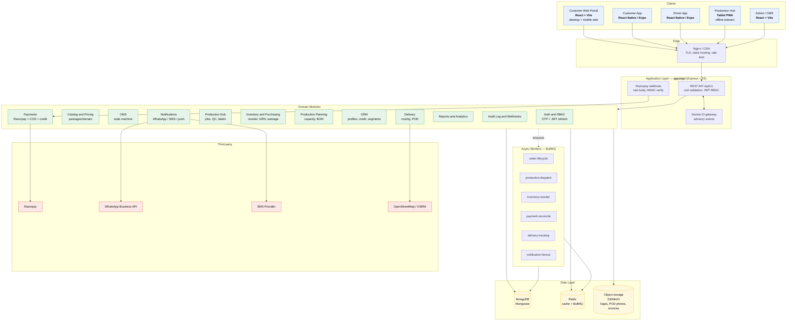
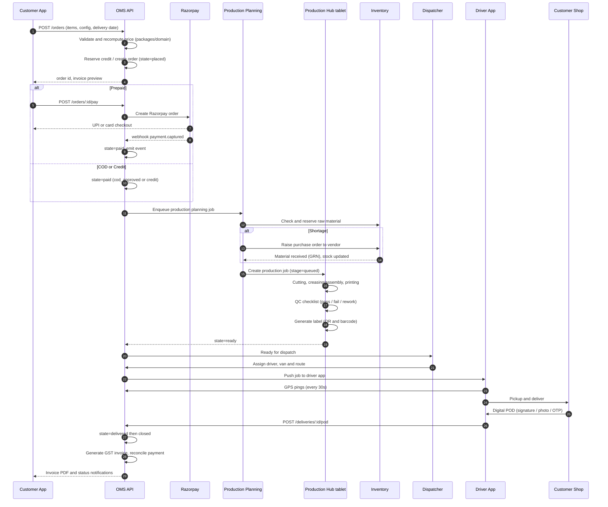
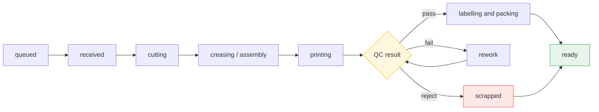

# Ameen Packaging — Platform Architecture

> Digital platform for a packaging-box manufacturing business in Tamil Nadu, India.
> Customers: bakeries, broast / chicken shops. They order parcel boxes in bulk.

**Status:** Proposed — awaiting approval
**Version:** 0.1
**Date:** 2026-10-20

---

## 1. Assumptions

These are the decisions I took where the brief left room. I have listed them so you can
correct any of them before M1 starts — most are cheap to change later, but the pricing
engine and the order state machine are expensive to change once the apps are live.

| # | Area | Assumption | Why |
|---|---|---|---|
| A1 | Backend framework | **Express** (not NestJS), with a strict layered modular-monolith structure (`routes → controllers → services → repositories → models`) | Lighter to boot, no decorator/DI magic, trivial BullMQ + Socket.IO wiring, faster to test. Module boundaries are the same as Nest would give you, so migrating later is mechanical. |
| A2 | Monorepo layout | `apps/*` for deployables, `packages/*` for shared libraries. Business logic that must run on **both** server and client (pricing, state machine, BOM) lives in `packages/domain` as pure functions | The customer configurator needs a live price quote in the browser *and* the server must recompute it authoritatively from the same code — one implementation, no drift. |
| A3 | Test runner | **Vitest** + `supertest` + `mongodb-memory-server` | Fast, native TS, first-class ESM, no separate config for the pnpm workspace. |
| A4 | Order quantities | B2B bulk. Minimum practical run = 250 units, typical order 500–5,000 units, price always per-unit | Bakeries buy in bulk; a per-unit price with volume tiers is the correct commercial model. |
| A5 | GST | Packaging falls under **HSN 4819**, taxed at **18%**. Intra-Tamil Nadu supply → **CGST 9% + SGST 9%**; inter-state → **IGST 18%**. Tax rate is **a data field on the SKU / customer**, not a constant | Tax rates and HSN codes change and differ by product classification. Hardcoding 18% would be a compliance bug waiting to happen. |
| A6 | Payments | Razorpay for online (UPI + cards + netbanking). **COD** and **credit terms** also supported — B2B bakeries commonly buy on 15/30-day credit | A packaging supplier that only accepts prepaid loses the customers that actually place volume orders. Credit limit lives in the CRM, enforced at order placement. |
| A7 | Printed vs blank | Both. `print: none` = plain blank box; printed adds a per-unit print cost + a one-time **plate/setup charge amortised across the run** | The amortised setup charge is the single most mis-quoted line in this business; it must be in the pricing engine from day one. |
| A8 | Production model | Make-to-order against a **capacity-based schedule** (machines with shift capacity), not make-to-stock. Finished goods are not inventoried | The whole flow in the brief (order → production request → job queue) is make-to-order. Raw material is the only stocked inventory. |
| A9 | Offline tolerance | Production Hub and Driver App work offline (IndexedDB / AsyncStorage queue) and sync when connectivity returns; the **server remains the source of truth** for state | The brief explicitly requires an offline-tolerant Production Hub and GPS tracking in factories with patchy signal. |
| A10 | Language | UI shipped in **English + Tamil** from M1 (i18n keys exist from the start, Tamil translations follow in M2–M3). Backend stores both `name` and `nameTa` on user-facing content | Retro-fitting i18n after the data model is set is the expensive path. |
| A11 | Maps | **OpenStreetMap + OSRM** for routing and **Haversine** for distance, with a pluggable provider interface so Google Maps can be swapped in later | OSM/OSRM need no paid API key, which keeps local dev and CI free. Tamil Nadu city routing quality is adequate for last-mile parcel delivery. |
| A12 | Notifications | **WhatsApp Business API** (primary, highest open rate for this customer base) → **SMS** (fallback) → **in-app/push** | WhatsApp is effectively the default channel for small Tamil Nadu businesses. |
| A13 | Deployment | Docker Compose for local + a single-region container host (ECS/Fly/Render) for staging, with MongoDB Atlas + Redis Cloud in production | Keeps local dev zero-dependency while leaving the Mongo/Redis topology identical across environments. |
| A14 | Real-time | Socket.IO for OMS live updates (order state, production progress, delivery tracking). WebSocket events are **advisory only** — clients always reconcile via REST | Socket.IO is a delivery optimisation, never the source of truth. |
| A15 | Packaging tech | Node 22 LTS, TypeScript 5.x `strict`, pnpm workspaces | — |

### Open questions (non-blocking, I will proceed with the default)

1. **Print partner** — is printing in-house (flexo/offset) or outsourced to a local print vendor? Assumption: in-house single-colour flexo, outsourced multi-colour, modelled as a `PrintProcess` with an optional external vendor.
2. **Fleet ownership** — does the business own vans or use a contract fleet? Assumption: own fleet of 3–5 vans with 4–6 drivers, modelled so contract drivers can be added.
3. **Invoice numbering** — assumed a financial-year series (`AMEEN/25-26/0001`) with a gap-free counter stored as a dedicated document (never `count+1`).

---
## 2. Architecture

### 2.1 System context



### 2.2 Order lifecycle across systems



### 2.3 Production Hub stage machine


## 3. Folder structure

```
ameen/
├── package.json                    # pnpm workspace root; scripts delegate to turbo
├── pnpm-workspace.yaml
├── turbo.json                      # task graph: build -> lint -> typecheck -> test
├── tsconfig.base.json
├── .env.example
├── docker-compose.yml              # mongo, redis, minio
├── README.md
├── CLAUDE.md                       # conventions, commands, architecture notes
│
├── docs/
│   ├── ARCHITECTURE.md             # this document
│   ├── API.md                      # generated from zod schemas (M2)
│   ├── RUNBOOK.md                  # deploy, rollback, incident (M6)
│   └── adr/                        # architecture decision records
│
├── apps/
│   ├── api/                        # THE CORE. Express + TS + Mongoose
│   │   ├── src/
│   │   │   ├── main.ts             # bootstrap: config -> db -> redis -> app -> listen
│   │   │   ├── app.ts              # express app assembly (no listen, for tests)
│   │   │   ├── worker.ts           # BullMQ worker entrypoint (separate process)
│   │   │   ├── config/
│   │   │   │   ├── env.ts          # zod-validated process.env
│   │   │   │   ├── db.ts
│   │   │   │   ├── redis.ts
│   │   │   │   ├── logger.ts
│   │   │   │   └── constants.ts
│   │   │   ├── core/
│   │   │   │   ├── errors/         # AppError, ErrorCode, problem+json mapper
│   │   │   │   ├── http/           # asyncHandler, pagination, filters
│   │   │   │   ├── middleware/     # auth, rbac, rateLimit, validate, audit, idempotency
│   │   │   │   ├── validation/     # zod helpers (params/query/body)
│   │   │   │   └── utils/          # money, dates, ids, pagination
│   │   │   ├── modules/            # one folder per domain module
│   │   │   │   ├── auth/           # controller, service, routes, schema, strategies
│   │   │   │   ├── users/
│   │   │   │   ├── catalog/        # SKUs, box templates, price rules
│   │   │   │   ├── pricing/        # delegates to packages/domain
│   │   │   │   ├── orders/         # OMS state machine
│   │   │   │   ├── payments/       # razorpay, webhooks, reconciliation
│   │   │   │   ├── production/     # jobs, stages, QC, labels
│   │   │   │   ├── inventory/      # stock, movements, reorder
│   │   │   │   ├── purchasing/     # vendors, POs, GRN
│   │   │   │   ├── planning/       # capacity, schedule, BOM
│   │   │   │   ├── crm/            # customer profiles, credit, segments
│   │   │   │   ├── delivery/       # routes, assignments, POD
│   │   │   │   ├── reports/
│   │   │   │   ├── notifications/  # whatsapp, sms, push, templates
│   │   │   │   ├── audit/
│   │   │   │   └── webhooks/
│   │   │   ├── jobs/               # queue definitions, processors, schedulers
│   │   │   ├── realtime/           # socket.io rooms, event bus
│   │   │   └── index.ts            # module registry
│   │   ├── tests/
│   │   │   ├── unit/
│   │   │   ├── integration/
│   │   │   ├── fixtures/
│   │   │   └── helpers/
│   │   └── Dockerfile
│   │
│   ├── admin-web/                  # Admin / OMS console. React + Vite + Tailwind
│   │   └── src/
│   │       ├── app/                # router, providers, layouts
│   │       ├── modules/            # orders, production, inventory, crm, delivery, reports
│   │       ├── components/         # ui primitives, tables, charts, layout
│   │       ├── hooks/
│   │       ├── lib/                # api client, query client, socket client
│   │       └── styles/
│   │
│   ├── customer-web/               # Customer portal (responsive; shares packages/ui-web)
│   │   └── src/
│   │       ├── app/
│   │       ├── modules/            # catalog, configurator, orders, invoices, payments
│   │       └── components/
│   │
│   ├── production-hub/             # Tablet PWA. React + Vite + VitePWA
│   │   └── src/
│   │       ├── app/
│   │       ├── modules/            # job-queue, station, qc, labelling
│   │       ├── offline/            # IndexedDB queue, sync engine, conflict rules
│   │       ├── components/         # large touch targets
│   │       └── styles/             # tablet-optimised
│   │
│   ├── customer-app/               # React Native / Expo
│   │   └── src/
│   │       ├── screens/            # catalog, configurator, cart, orders, invoices
│   │       ├── navigation/
│   │       ├── api/
│   │       └── store/
│   │
│   └── driver-app/                 # React Native / Expo
│       └── src/
│           ├── screens/            # jobs, navigation, pickup, delivery, POD
│           ├── navigation/
│           ├── api/
│           ├── maps/
│           └── store/
│
├── packages/
│   ├── domain/                     # PURE business logic. No I/O. Runs server + client
│   │   └── src/
│   │       ├── pricing/            # engine, rules, tax, discount, amortised setup
│   │       ├── order-state/        # state machine, transitions, guards
│   │       ├── production-state/   # stage machine
│   │       ├── bom/                # material requirement calculation
│   │       ├── money/              # paise-based integer money helpers
│   │       └── index.ts
│   │
│   ├── ui-web/                     # shared React components for the 3 web apps
│   ├── ui-native/                  # shared React Native components
│   ├── api-client/                 # typed fetch client, zod response parsing, auth
│   ├── config-typescript/          # shared tsconfig
│   ├── config-eslint/
│   ├── config-tailwind/            # shared design tokens
│   ├── i18n/                       # en + ta dictionaries
│   ├── eslint-config/
│   └── tsconfig/                   # workspace tsconfig presets
│
├── docker/
│   ├── api.Dockerfile
│   ├── worker.Dockerfile
│   ├── web.Dockerfile
│   └── nginx.conf
│
├── .github/workflows/
│   ├── ci.yml
│   └── release.yml
└── tools/
    ├── seed/                       # demo data: bakeries, SKUs, vendors, drivers
    └── scripts/
```

### Module conventions (every `modules/<name>/`)

```
modules/<name>/
├── <name>.routes.ts        # route table, wired into the v1 router
├── <name>.controller.ts    # HTTP only: parse, delegate, map to response
├── <name>.service.ts       # business rules, transactions, orchestration
├── <name>.repository.ts    # Mongoose queries only, no business logic
├── <name>.schema.ts        # Mongoose model + zod schemas + inferred TS types
├── <name>.events.ts        # domain events emitted/consumed by this module
└── <name>.test.ts          # colocated unit tests
```

**Layering rules (enforced by review, not by framework):**
- Controllers never touch Mongoose. They call exactly one service method.
- Services may call other services and repositories, but never another module's repository directly.
- Repositories never import from `core/` beyond `utils` and `errors`.
- Business rules that must run in the client live in `packages/domain`, not in a service.
- Every state change emits a domain event; side effects (notification, PDF, webhook) subscribe to it.

---
## 4. MongoDB data model

All schemas use Mongoose with `timestamps: true`. Money is stored as **integer paise**
(`number`, minor unit) — never floats. Dates are UTC `Date`. All documents carry a
`schemaVersion` for future migrations.

### 4.1 `users`

| Field | Type | Notes |
|---|---|---|
| `phone` | string, unique, indexed | E.164 (`+919876543210`). The primary login identity. |
| `email` | string, sparse, unique | Secondary. |
| `passwordHash` | string, nullable | Argon2id. Null for OTP-only customer accounts. |
| `name`, `nameTa` | string | Tamil name optional. |
| `role` | enum | `customer \| admin \| production \| inventory \| dispatcher \| driver \| finance` |
| `status` | enum | `active \| invited \| suspended \| archived` |
| `customerId` | ObjectId ref `customers`, nullable | Set when `role=customer`. |
| `driverId` | ObjectId ref `drivers`, nullable | Set when `role=driver`. |
| `mfaEnabled` | boolean | TOTP, for staff roles. |
| `locale` | enum | `en \| ta` |
| `lastLoginAt` | Date, nullable | |
| `failedLoginAttempts` | number | Locks the account after 5 within 15 min. |

Indexes: `phone` unique, `email` unique sparse, `role+status`.

### 4.2 `otp_codes`

| Field | Type | Notes |
|---|---|---|
| `phone` | string, indexed | |
| `purpose` | enum | `login \| register \| reset_password \| delivery_otp \| verify_pod` |
| `codeHash` | string | Hashed, never stored plaintext. |
| `attempts` | number | Max 5. |
| `expiresAt` | Date, TTL index | 5-minute expiry. |
| `consumedAt` | Date, nullable | |

Indexes: `expiresAt` TTL, `phone+purpose`.

### 4.3 `refresh_tokens`

| Field | Type | Notes |
|---|---|---|
| `userId` | ObjectId ref `users`, indexed | |
| `tokenHash` | string, unique | SHA-256 of the token. |
| `family` | string | Rotation family. Reuse of a rotated token revokes the whole family. |
| `userAgent`, `ip` | string | For the device list. |
| `expiresAt` | Date, TTL index | 30 days. |
| `revokedAt` | Date, nullable | |

### 4.4 `customers` (CRM)

| Field | Type | Notes |
|---|---|---|
| `customerCode` | string, unique | `CUS-0001`. |
| `businessName`, `businessNameTa` | string | Shop name. |
| `contactName`, `contactNameTa` | string | |
| `phone`, `email` | string | |
| `gstin` | string, nullable, unique sparse | 15 chars. |
| `pan` | string, nullable | |
| `segment` | enum | `walk_in \| small \| mid \| large \| enterprise` |
| `priceTier` | enum ref `price_tiers` | Determines default price rule. |
| `creditLimit` | integer paise | 0 = no credit. |
| `creditUsed` | integer paise | Outstanding. |
| `paymentTermsDays` | number | 0 = COD/prepaid, 15/30 = credit. |
| `addresses` | embedded array | See below. |
| `notes` | string | |
| `tags` | string[] | |
| `isBlacklisted` | boolean | |
| `totalOrderValue`, `orderCount` | integer paise / number | Denormalised counters, updated on order close. |

**Address sub-document:** `label`, `contactName`, `phone`, `line1`, `line2`, `area`, `city`, `district`, `state` (`TN`), `pincode`, `geo: { type: 'Point', coordinates: [lng, lat] }`, `isDefault`.

Indexes: `phone` unique-ish, `gstin` unique sparse, `city+segment`, `geo` (2dsphere).

### 4.5 `catalog_skus` (box products)

A SKU is a *box definition*. Custom orders are permutations of these with dimension overrides.

| Field | Type | Notes |
|---|---|---|
| `skuCode` | string, unique | `BOX-KR-12X9X4`. |
| `name`, `nameTa` | string | |
| `category` | enum | `parcel_box \| cake_box \| burger_box \| chicken_basket \| tray \| liner` |
| `material` | enum | `kraft \| corrugated_3ply \| corrugated_2ply \| whiteboard \| paperboard \| plastic` |
| `dimensions` | `{ length, width, height, unit: 'mm' }` | Flat blank defines the die; box dims define the finished size. |
| `flute` | enum, nullable | `B \| C \| E \| BC` for corrugated. |
| `gsm` | number, nullable | Paper weight. |
| `print` | `{ type: 'none'\|'single'\|'multi', sides: number, colors: number }` | |
| `pricing` | `{ basePricePaise, minQty, taxRate, hsnCode }` | Per-unit. |
| `bom` | array | See 4.6. |
| `leadTimeDays` | number | Default promise. |
| `isActive` | boolean | |
| `tags` | string[] | |

Indexes: `skuCode` unique, `category+isActive`, `text` index on name for search.

### 4.6 `bom_templates` (bill of materials per unit)

| Field | Type | Notes |
|---|---|---|
| `skuId` | ObjectId ref `catalog_skus` | |
| `materialId` | ObjectId ref `materials` | The raw material consumed. |
| `quantityPerUnit` | number | e.g. 0.42 sq m of kraft sheet per box. |
| `unit` | enum | `sq_m \| sheet \| kg \| ml \| pcs` |
| `wastagePct` | number | Industry waste allowance, default 3%. |
| `isPrimary` | boolean | Primary vs auxiliary (glue). |

### 4.7 `materials` (raw material inventory master)

| Field | Type | Notes |
|---|---|---|
| `materialCode` | string, unique | `RAW-KRAFT-120` |
| `name`, `nameTa` | string | |
| `category` | enum | `kraft_paper \| corrugated_sheet \| ink \| glue \| thread \| tape \| label_stock` |
| `unit` | enum | `sq_m \| sheet \| kg \| ml \| roll \| pcs` |
| `packSize` | number | Units per purchase pack. |
| `unitCostPaise` | integer paise | Moving average cost. |
| `taxRate` | number | GST on purchase. |
| `hsnCode` | string | |
| `reorderPoint` | number | Below this, raise a PO. |
| `reorderQuantity` | number | Default PO qty. |
| `leadTimeDays` | number | |
| `vendorId` | ObjectId ref `vendors` | Primary vendor. |
| `storageLocation` | string | Racked location. |
| `isActive` | boolean | |

### 4.8 `inventory_stock`

One document per `(materialId, location)`. The live balance.

| Field | Type | Notes |
|---|---|---|
| `materialId` | ObjectId ref `materials`, indexed | |
| `location` | string | `STORE-1`, `RACK-A2`. |
| `onHand` | number | Physical quantity. |
| `reserved` | number | Allocated to production jobs, not yet consumed. |
| `available` | number | Computed: `onHand - reserved`. Denormalised for query speed. |
| `averageCostPaise` | integer paise | Moving weighted average. |
| `lastMovementAt` | Date | |

Unique index: `(materialId, location)`.

### 4.9 `inventory_movements` (append-only ledger)

| Field | Type | Notes |
|---|---|---|
| `materialId` | ObjectId ref `materials`, indexed | |
| `type` | enum | `receipt \| consumption \| reservation \| release \| adjustment \| wastage \| return` |
| `quantity` | number | Signed: `+` in, `-` out. |
| `unitCostPaise` | integer paise | Cost at time of movement. |
| `balanceAfter` | number | Running balance for reconciliation. |
| `referenceType` | enum | `purchase_order \| production_job \| manual \| delivery` |
| `referenceId` | ObjectId | |
| `location` | string | |
| `note` | string | |
| `performedBy` | ObjectId ref `users` | |
| `occurredAt` | Date | |

Indexes: `materialId+occurredAt`, `referenceType+referenceId`. **Append-only** — corrections are new `adjustment` entries, never edits. `balanceAfter` is verified nightly by a reconciliation job.

### 4.10 `vendors` (raw material suppliers)

| Field | Type | Notes |
|---|---|---|
| `vendorCode` | string, unique | |
| `name`, `nameTa` | string | |
| `type` | enum | `raw_material \| print_partner \| packaging_other` |
| `gstin` | string, nullable | |
| `phone`, `email` | string | |
| `address` | object | |
| `paymentTermsDays` | number | |
| `rating` | number | 1–5. |
| `isActive` | boolean | |

### 4.11 `purchase_orders`

| Field | Type | Notes |
|---|---|---|
| `poNumber` | string, unique | `PO/25-26/0007`. |
| `vendorId` | ObjectId ref `vendors` | |
| `items` | array | `{ materialId, quantity, unit, unitCostPaise, taxRate, receivedQty, lineTotalPaise }` |
| `status` | enum | `draft \| sent \| partially_received \| received \| cancelled` |
| `totalPaise`, `taxPaise`, `grandTotalPaise` | integer paise | |
| `expectedDeliveryDate` | Date | |
| `notes` | string | |
| `sentAt`, `receivedAt` | Date, nullable | |
| `createdBy` | ObjectId ref `users` | |

### 4.12 `goods_receipts` (GRN)

| Field | Type | Notes |
|---|---|---|
| `grnNumber` | string, unique | |
| `purchaseOrderId` | ObjectId ref `purchase_orders` | |
| `vendorId` | ObjectId ref `vendors` | |
| `items` | array | `{ materialId, orderedQty, receivedQty, rejectedQty, unitCostPaise, binLocation }` |
| `invoiceNumber`, `invoiceDate` | string, Date | Vendor's GST invoice. |
| `status` | enum | `draft \| posted \| cancelled` |
| `postedAt` | Date, nullable | Posting creates the `inventory_movements` entries and updates `inventory_stock`. |
| `postedBy` | ObjectId ref `users` | |

### 4.13 `orders`

The central document. Indexed for the OMS list view and by customer.

| Field | Type | Notes |
|---|---|---|
| `orderNumber` | string, unique | `ORD/25-26/000123`. |
| `customerId` | ObjectId ref `customers`, indexed | |
| `status` | enum | Order state (see §5). |
| `stateHistory` | array | `{ from, to, at, by, reason, note }` |
| `items` | array | See below. |
| `pricing` | object | `{ subtotalPaise, discountPaise, taxPaise, cgstPaise, sgstPaise, igstPaise, roundOffPaise, grandTotalPaise, currency: 'INR' }` |
| `payment` | object | `{ method: 'razorpay'\|'cod'\|'credit', status: 'pending'\|'paid'\|'failed'\|'refunded'\|'partial', razorpayOrderId, razorpayPaymentId, paidAt, amountPaidPaise, refunds: [...] }` |
| `deliveryAddress` | object | Snapshot of the customer address at order time. |
| `requestedDeliveryDate` | Date | |
| `promisedDeliveryDate` | Date | After capacity scheduling. |
| `notes`, `internalNotes` | string | |
| `quoteId` | ObjectId ref `quotes`, nullable | |
| `invoiceId` | ObjectId ref `invoices`, nullable | |
| `deliveryId` | ObjectId ref `deliveries`, nullable | |
| `createdBy` | ObjectId ref `users` | Self-serve customers set their own id. |
| `source` | enum | `customer_app \| customer_web \| admin \| phone \| repeat` |
| `isRepeat` | boolean | Set on reorder. |
| `cancelledAt`, `cancelReason` | Date, string | |
| `placedAt`, `closedAt` | Date, nullable | |

**Item sub-document:**

| Field | Type | Notes |
|---|---|---|
| `skuId` | ObjectId ref `catalog_skus` | |
| `skuCode`, `name` | string | Snapshot for stable display. |
| `quantity` | number | Units. |
| `dimensions` | object | Overrides for custom sizing. |
| `material` | enum | |
| `printSpec` | object | `{ type, sides, colors, artworkUrl, notes, plateChargePaise }` |
| `unitPricePaise` | integer paise | After tier + discount. |
| `basePricePaise` | integer paise | Before discount. |
| `setupChargePaise` | integer paise | Amortised print plate charge, billed once. |
| `discountPaise` | integer paise | |
| `taxRate` | number | |
| `lineTotalPaise` | integer paise | `quantity * unitPrice + setupCharge`, tax excluded. |
| `bomSnapshot` | array | Material requirements frozen at order time. |

Indexes: `orderNumber` unique, `customerId+createdAt`, `status+requestedDeliveryDate`, `status+createdAt`.

### 4.14 `price_tiers` and `price_rules`

**`price_tiers`:** `code`, `name`, `minOrderValuePaise`, `discountPct`, `appliesTo` (segment or customer), `priority`, `isActive`.

**`price_rules`:** `name`, `scope` (`sku` \| `category` \| `customer` \| `segment`), `skuId`/`category`/`customerId`/`segment` (whichever applies), `ruleType` (`percentage` \| `fixed_per_unit` \| `fixed_per_order`), `value`, `minQty`, `maxQty`, `priority`, `validFrom`, `validTo`, `isActive`.

Rules are evaluated in `priority` order; the first match wins per rule type, then the best (lowest) unit price is chosen. The **server always recomputes** — the client's quote is display-only.

### 4.15 `quotes` (pre-order, negotiated pricing)

| Field | Type | Notes |
|---|---|---|
| `quoteNumber` | string, unique | |
| `customerId` | ObjectId ref `customers` | |
| `items` | array | Same shape as order items. |
| `pricing` | object | |
| `status` | enum | `draft \| sent \| accepted \| rejected \| expired \| converted` |
| `validUntil` | Date | |
| `convertedOrderId` | ObjectId ref `orders`, nullable | |

### 4.16 `production_jobs`

| Field | Type | Notes |
|---|---|---|
| `jobNumber` | string, unique | `JOB/000451`. |
| `orderId` | ObjectId ref `orders`, indexed | |
| `orderNumber` | string | Snapshot. |
| `items` | array | Per-item production detail: `skuId`, `quantity`, `completedQty`, `wastedQty`. |
| `stage` | enum | `queued \| received \| cutting \| creasing \| assembly \| printing \| qc \| labelling \| packing \| ready \| scrapped \| cancelled` |
| `stageHistory` | array | `{ stage, at, by, deviceId, offline: boolean }` |
| `priority` | number | Lower = sooner. |
| `scheduledDate` | Date | From capacity planning. |
| `machineId` | ObjectId ref `machines`, nullable | |
| `operatorId` | ObjectId ref `users`, nullable | |
| `materialReservations` | array | `{ materialId, quantity, consumedQty }` |
| `qc` | object | `{ checklist: [...], result, checkedBy, checkedAt, reworkCount, notes }` |
| `label` | object | `{ qrPayload, barcodeValue, labelUrl, printedAt }` |
| `quantityCompleted` | number | |
| `quantityScrapped` | number | |
| `offlineCompleted` | boolean | True if synced from a device. |

Indexes: `orderId`, `stage+scheduledDate`, `stage+priority`.

### 4.17 `qc_checklists` (templates)

| Field | Type | Notes |
|---|---|---|
| `name` | string | |
| `appliesTo` | enum | `material \| category \| sku` |
| `material` / `category` / `skuId` | | Discriminator. |
| `items` | array | `{ code, label, labelTa, type: 'pass_fail'\|'numeric'\|'text', min?, max?, unit?, required }` |
| `isActive` | boolean | |

### 4.18 `machines` and `shifts` (capacity)

**`machines`:** `code`, `name`, `type` (`die_cutter` \| `creaser` \| `printer` \| `laminator` \| `assembler`), `capacityPerShift`, `shiftHours` (`[{ name, start, end }]`), `activeJobs` (derived), `isActive`, `maintenanceDueDate`.

**`shifts`:** `name`, `startMinutes`, `endMinutes`, `isNight`, `days` (array of weekday).

### 4.19 `delivery_routes`, `deliveries`, `drivers`, `vehicles`

**`deliveries`**
| Field | Type | Notes |
|---|---|---|
| `deliveryNumber` | string, unique | |
| `orderId` | ObjectId ref `orders`, unique | One delivery per order for now. |
| `customerId` | ObjectId ref `customers` | |
| `address` | object | Snapshot with geo point. |
| `status` | enum | `unassigned \| assigned \| picked_up \| in_transit \| delivered \| failed \| rescheduled \| returned` |
| `driverId` | ObjectId ref `drivers`, nullable | |
| `vehicleId` | ObjectId ref `vehicles`, nullable | |
| `routeId` | ObjectId ref `delivery_routes`, nullable | |
| `sequence` | number | Stop order within the route. |
| `pickup` | object | `{ at, lat, lng, by }` |
| `pod` | object | `{ method: 'signature'\|'photo'\|'otp', signatureUrl, photoUrl, otpVerifiedAt, recipientName, notes, at, lat, lng }` |
| `failedReason` | string | |
| `proofOfDeliveryOtp` | string, hashed | Verified against the customer phone. |
| `plannedAt`, `deliveredAt` | Date, nullable | |
| `distanceKm`, `etaMinutes` | number | |
| `trackings` | array | Capped at 500 points; older ones archived. |

Indexes: `orderId` unique, `driverId+status`, `status+plannedAt`, `geo` 2dsphere.

**`drivers`:** `driverCode`, `name`, `nameTa`, `phone` (unique), `vehicleIds`, `isActive`, `currentLocation` (`{ lat, lng, at, heading }`), `rating`, `totalDeliveries`, `licenseNumber`, `licenseExpiry`.

**`vehicles`:** `vehicleCode` (unique), `type` (`van` \| `mini_truck` \| `bike`), `registrationNumber` (unique), `capacityKg`, `capacityBoxes`, `isActive`, `insuranceExpiry`.

**`delivery_routes`:** `routeDate`, `driverId`, `vehicleId`, `stops` (array of deliveryIds), `totalDistanceKm`, `totalDurationMinutes`, `status` (`planned` \| `in_progress` \| `completed`), `optimisedAt`.

### 4.20 `invoices` and `payments`

**`invoices`**
| Field | Type | Notes |
|---|---|---|
| `invoiceNumber` | string, unique | `AMEEN/25-26/0001` (gap-free). |
| `orderId`, `customerId` | ObjectId | |
| `financialYear` | string | `25-26`. |
| `items` | array | `{ description, hsnCode, qty, unit, unitPricePaise, taxRate, cgstPaise, sgstPaise, igstPaise, lineTotalPaise }` |
| `placeOfSupply` | string | State code. |
| `supplierGstin`, `customerGstin` | string | |
| `subtotalPaise`, `discountPaise`, `cgstPaise`, `sgstPaise`, `igstPaise`, `roundOffPaise` | integer paise | |
| `grandTotalPaise` | integer paise | |
| `amountInWords` | string | Indian numbering (Rupees One Lakh... only). |
| `status` | enum | `unpaid \| partial \| paid \| overdue \| cancelled \| credited` |
| `pdfUrl` | string | |
| `issuedAt`, `dueDate` | Date | |
| `paymentIds` | ObjectId[] | |

**`payments`**
| Field | Type | Notes |
|---|---|---|
| `paymentNumber` | string, unique | |
| `orderId`, `invoiceId`, `customerId` | ObjectId | |
| `provider` | enum | `razorpay \| cash \| bank_transfer \| cheque` |
| `method` | enum | `upi \| card \| netbanking \| cod \| credit` |
| `amountPaise` | integer paise | |
| `currency` | string | `INR`. |
| `status` | enum | `created \| authorized \| captured \| failed \| refunded \| partially_refunded` |
| `providerOrderId`, `providerPaymentId` | string, unique sparse | Razorpay ids. |
| `feePaise` | integer paise | Gateway fee. |
| `refunds` | array | `{ amountPaise, reason, providerRefundId, at, by }` |
| `reconciled` | boolean | |
| `reconciledAt` | Date, nullable | |
| `method` details | object | `upiId`, `last4`, `bank` — only what is safe to store. |

**`razorpay_webhooks`** (idempotency ledger)
| Field | Type | Notes |
|---|---|---|
| `eventId` | string, unique | Provider event id — the idempotency key. |
| `event` | string | `payment.captured` etc. |
| `payload` | object | Raw body, retained 90 days. |
| `status` | enum | `received \| processed \| failed \| ignored` |
| `processedAt` | Date, nullable | |
| `error` | string | |

### 4.21 `notifications` and `templates`

**`notification_templates`:** `key` (unique, e.g. `order.dispatched`), `channel` (`whatsapp` \| `sms` \| `push` \| `email`), `locale` (`en` \| `ta`), `subject`, `body` (Handlebars-style `{{placeholders}}`), `variables` (array of names), `isActive`.

**`notifications`:** `recipientType` (`user` \| `customer` \| `driver`), `recipientId`, `channel`, `templateKey`, `locale`, `payload`, `status` (`queued` \| `sent` \| `delivered` \| `failed`), `providerMessageId`, `error`, `sentAt`, `readAt`.

### 4.22 `audit_logs`

| Field | Type | Notes |
|---|---|---|
| `actorId` | ObjectId ref `users`, nullable | Null for system/webhook actions. |
| `actorRole` | string | |
| `action` | string | `order.transition`, `inventory.adjust`, `qc.fail`, etc. |
| `entityType` | string | `order`, `production_job`, `material`... |
| `entityId` | ObjectId | |
| `before` / `after` | object | Diff snapshot. |
| `ip`, `userAgent` | string | |
| `requestId` | string | Correlates with the HTTP log line. |
| `occurredAt` | Date, indexed | TTL after 2 years. |

### 4.23 `webhook_endpoints` and `webhook_deliveries`

**`webhook_endpoints`:** `ownerType` (`customer` \| `system`), `ownerId`, `url`, `secretEncrypted`, `events` (string[]), `isActive`, `lastDeliveryAt`, `failureCount`.

**`webhook_deliveries`:** `endpointId`, `event`, `payload`, `status` (`pending` \| `delivered` \| `failed`), `attempts`, `responseStatus`, `nextRetryAt`, `deliveredAt`.

### 4.24 `counters` (gap-free numbering)

| Field | Type | Notes |
|---|---|---|
| `key` | string, unique | `invoice:25-26`, `order:25-26`, `po:25-26`. |
| `value` | number | Current value. |
| `period` | string | Financial year. |

Increment is done with `findOneAndUpdate({ key }, { $inc: { value: 1 } }, { upsert: true })` — atomic, no read-then-write race.

### 4.25 `settings`

Key-value store for tenant-wide configuration: `key` (unique), `value` (mixed), `updatedBy`, `updatedAt`. Used for GST defaults, business hours, delivery slots, notification toggles.

### 4.26 `companies` (org profile, singleton)

Single document (`_id: 'org'`) describing the business itself, editable by `settings:write` (admin only), readable by `settings:read`: `name`, `address`, `phone` (E.164), `website` (URL), `logo` (URL or storage key), `gstin` (validated GSTIN, uppercased). Served at `GET/PUT /api/v1/company`; the GET returns an all-empty profile until first save. Feeds invoice headers and console branding.

---
## 5. Order state machine

The OMS state machine lives in `packages/domain/src/order-state/` as pure functions so
the client can render a valid action set and the server remains authoritative. Every
transition is guarded by a role check, a precondition predicate, and side effects that
run inside a MongoDB transaction.

### 5.1 States

| State | Meaning | Owner |
|---|---|---|
| `draft` | Customer started but did not submit | customer |
| `placed` | Submitted, awaiting payment/confirmation | customer/admin |
| `payment_pending` | Online payment initiated, webhook not yet received | system |
| `paid` | Payment confirmed (prepaid, COD approved, or on credit) | system |
| `planned` | Production scheduled, materials reserved | production |
| `in_production` | Job is running on a station | production |
| `qc` | Awaiting / undergoing quality check | production |
| `ready` | QC passed, labels generated, ready to dispatch | production |
| `dispatched` | Assigned to a driver, in transit | dispatcher/driver |
| `delivered` | POD captured, shop confirmed | driver |
| `closed` | Invoiced, payment reconciled, order archived | system/finance |
| `cancelled` | Cancelled before dispatch | customer/admin |
| `on_hold` | Paused — credit issue, material shortage, customer request | admin |

### 5.2 Transition table

| From | To | Trigger | Guard | Side effects |
|---|---|---|---|---|
| `draft` | `placed` | Customer submits | Items non-empty; stock availability not required yet | Order number assigned; BOM computed; notification |
| `placed` | `payment_pending` | Razorpay order created | Method = razorpay | Razorpay order id stored |
| `placed` | `paid` | COD approved / credit terms | Credit limit not exceeded; no open overdues | Order confirmed notification |
| `payment_pending` | `paid` | `payment.captured` webhook | Idempotency: `eventId` not seen | Payment doc created; invoice drafted; planning enqueued |
| `payment_pending` | `placed` | `payment.failed` webhook | — | Failure notification; user can retry |
| `paid` | `planned` | Planning job succeeds | Materials reserved (or shortage raised as a PO) | Production job created; `promisedDeliveryDate` set |
| `paid` | `on_hold` | Admin | Reason required | Notification to customer + admin |
| `on_hold` | `paid` | Admin resolves | Reason required | — |
| `planned` | `in_production` | Station starts | Job exists | Notification |
| `in_production` | `qc` | Job completes production | Completed qty > 0 | QC checklist attached |
| `qc` | `ready` | QC passes | All required checks pass | Label generated; stage `ready` |
| `qc` | `in_production` | QC fails, rework | Rework count < limit | Rework job created; wastage recorded |
| `qc` | `cancelled` | QC rejects, beyond limit | Rework count exhausted | Wastage recorded; refund/credit note |
| `ready` | `dispatched` | Dispatcher assigns | Driver + vehicle available | Delivery created; driver notified |
| `dispatched` | `delivered` | POD captured | POD complete (signature or photo or OTP) | Invoice finalised; customer notified |
| `delivered` | `closed` | Reconcile job / admin | Payment settled (or written off) | Credit updated; counters updated; closed date |
| `placed` | `cancelled` | Customer/admin | Before dispatch | Stock released; refund if prepaid |
| `paid` | `cancelled` | Admin | Reason required | Refund issued; inventory released |
| `planned`/`in_production` | `cancelled` | Admin | Reason required | Job cancelled; material released; refund issued |
| any | `rescheduled` | Delivery failed | — | Delivery rescheduled; customer notified |

### 5.3 Rules

- Transitions are **forward-only** except `qc → in_production` (rework) and the
  `on_hold` / `cancelled` exits. A `closed` order is immutable.
- Every transition appends to `stateHistory`: `{ from, to, at, by, reason, note }`.
- A transition that fails its guard throws `AppError` with `ErrorCode.INVALID_TRANSITION`
  and returns the allowed transitions in the error details, so the UI can grey out
  invalid actions.
- All transitions run in a MongoDB transaction (replica set required) together with the
  material reservation and payment updates. Compensation logic exists for the
  non-transactional side effects (emails, PDFs, webhooks) — they are retried by BullMQ.

### 5.4 Roles and permitted transitions

| Role | Can trigger |
|---|---|
| `customer` | `draft→placed`, `placed→cancelled` |
| `admin` | All except `payment_pending→paid` (webhook only) |
| `production` | `planned→in_production`, `in_production→qc`, `qc→ready`, `qc→in_production` |
| `inventory` | `on_hold→paid` (material received), `paid→cancelled` (material unavailable) |
| `dispatcher` | `ready→dispatched`, delivery reschedule |
| `driver` | `dispatched→delivered` (POD) |
| `finance` | `delivered→closed`, `placed→paid` (manual/credit approval) |

---
## 6. API surface

All routes are prefixed `/api/v1`. Responses are JSON. Errors use a consistent envelope.
Auth is `Authorization: Bearer <accessToken>`; the access token lives 15 minutes, the
refresh token 30 days and rotates on use.

**Conventions**
- IDs are 24-char Mongo ObjectIds, validated by zod before hitting a repository.
- Money is always an integer field suffixed `Paise` in the API too — never a float.
- Dates are ISO-8601 UTC strings.
- Every list endpoint accepts `page`, `limit`, `sort`, and module-specific filters.
- Write endpoints accept an `Idempotency-Key` header on payment and order creation.

### 6.1 Auth & users — `/api/v1/auth`, `/api/v1/users`

| Method | Path | Role | Purpose |
|---|---|---|---|
| POST | `/auth/otp/request` | public | Send OTP to phone. Rate limited 3/min, 10/hour. |
| POST | `/auth/otp/verify` | public | Verify OTP, issue access + refresh tokens. |
| POST | `/auth/register` | public | Create a customer account (phone, business name, GSTIN optional). |
| POST | `/auth/login` | public | Password login (staff + customers with a password). |
| POST | `/auth/refresh` | public | Rotate refresh token, issue a new access token. |
| POST | `/auth/logout` | auth | Revoke the refresh token family. |
| POST | `/auth/logout-all` | auth | Revoke every session for the user. |
| GET | `/auth/me` | auth | Current user profile + role + permissions. |
| PUT | `/auth/me` | auth | Update own profile. |
| PUT | `/auth/password` | auth | Change password. |
| GET | `/auth/sessions` | auth | List active sessions. |
| GET | `/users` | admin | List staff users. |
| POST | `/users` | admin | Invite a staff user. |
| GET | `/users/:id` | admin | User detail. |
| PATCH | `/users/:id` | admin | Update role/status. |
| GET | `/users/roles` | admin | List roles and permission matrix. |

### 6.2 Catalog & pricing — `/api/v1/catalog`, `/api/v1/pricing`

| Method | Path | Role | Purpose |
|---|---|---|---|
| GET | `/catalog/skus` | auth | List box SKUs. Filters: `category`, `material`, `search`, `minPrice`, `maxPrice`. |
| GET | `/catalog/skus/:id` | auth | SKU detail with BOM and pricing. |
| GET | `/catalog/categories` | auth | Category tree with counts. |
| GET | `/catalog/templates` | auth | Box templates for the configurator. |
| GET | `/catalog/bom/:skuId` | auth | Material requirement per unit. |
| POST | `/pricing/quote` | auth | **Live price quote** for a configurator payload. Recomputes authoritatively. |
| GET | `/pricing/rules` | admin | List price rules and tiers. |
| POST | `/pricing/rules` | admin | Create a price rule. |
| PATCH | `/pricing/rules/:id` | admin | Update a price rule. |
| DELETE | `/pricing/rules/:id` | admin | Soft-delete a price rule. |
| GET | `/pricing/tiers` | admin | List price tiers. |

### 6.3 Orders (OMS) — `/api/v1/orders`

| Method | Path | Role | Purpose |
|---|---|---|---|
| POST | `/orders` | customer/admin | Create an order. Server recomputes the price. |
| GET | `/orders` | auth | List orders. Filters: `status`, `customerId`, `from`, `to`, `paymentStatus`, `deliveryDate`. |
| GET | `/orders/:id` | auth | Order detail (role-scoped). |
| PATCH | `/orders/:id` | customer/admin | Edit a `draft` order only. |
| POST | `/orders/:id/cancel` | customer/admin | Cancel with a reason. |
| GET | `/orders/:id/track` | auth | Timeline + production progress + delivery tracking. |
| GET | `/orders/:id/invoice` | auth | GST invoice PDF. |
| GET | `/orders/:id/label` | auth | Production / delivery label PDF. |
| POST | `/orders/:id/pay` | customer | Create a Razorpay order. |
| POST | `/orders/:id/transition` | staff | Explicit state transition (admin/production/dispatcher). |
| GET | `/orders/:id/transitions` | auth | Allowed transitions for the current user. |
| POST | `/orders/:id/notes` | staff | Add an internal note. |
| GET | `/orders/:id/audit` | admin | Audit trail for the order. |

### 6.4 Quotes — `/api/v1/quotes`

| Method | Path | Role | Purpose |
|---|---|---|---|
| GET | `/quotes` | auth | List quotes (admin: all, customer: own). |
| POST | `/quotes` | staff | Create a quote with negotiated pricing. |
| GET | `/quotes/:id` | auth | Quote detail. |
| PATCH | `/quotes/:id` | staff | Update a draft quote. |
| POST | `/quotes/:id/send` | staff | Send to customer. |
| POST | `/quotes/:id/accept` | customer | Accept → converts to an order. |
| POST | `/quotes/:id/reject` | customer | Reject with a reason. |

### 6.5 Payments — `/api/v1/payments`, `/api/v1/webhooks`

| Method | Path | Role | Purpose |
|---|---|---|---|
| POST | `/payments/create-order` | customer | Create a Razorpay order for an invoice/order. |
| POST | `/payments/:id/verify` | customer | Verify a Razorpay payment signature. |
| GET | `/payments` | auth | List payments. |
| GET | `/payments/:id` | auth | Payment detail. |
| POST | `/payments/:id/refund` | finance/admin | Full or partial refund. |
| POST | `/payments/record` | finance | Record an offline payment (cash, bank transfer, cheque). |
| GET | `/payments/reconciliation` | finance | Gateway vs. ledger reconciliation report. |
| POST | `/payments/:id/reconcile` | finance | Mark reconciled. |
| GET | `/invoices` | auth | List invoices. |
| GET | `/invoices/:id` | auth | Invoice detail. |
| GET | `/invoices/:id/pdf` | auth | Invoice PDF download. |
| POST | `/webhooks/razorpay` | public | Razorpay webhook (raw body, HMAC-SHA256 signature verify). |
| POST | `/webhooks/:id` | public | Customer webhooks (HMAC signature). |

### 6.6 Production Hub — `/api/v1/production`

| Method | Path | Role | Purpose |
|---|---|---|---|
| GET | `/production/jobs` | production | Job queue. Filters: `stage`, `date`, `priority`, `machineId`. |
| GET | `/production/jobs/:id` | production | Job detail with BOM, reservations, QC checklist, history. |
| POST | `/production/jobs/:id/start` | production | Move to `in_production` (claim a station). |
| POST | `/production/jobs/:id/stage` | production | Advance to the next stage. Body: `{ stage, completedQty, deviceId, offline }`. |
| POST | `/production/jobs/:id/qc` | production | Submit QC result: `{ checklist, result: pass\|fail\|reject, notes }`. |
| POST | `/production/jobs/:id/rework` | production | Request rework. |
| POST | `/production/jobs/:id/wastage` | production | Record wastage (material + qty). |
| GET | `/production/jobs/:id/label` | production | Label PDF (QR + barcode) or ZPL for a thermal printer. |
| POST | `/production/jobs/:id/label/print` | production | Mark the label printed. |
| POST | `/production/sync` | production | **Offline batch sync** from a tablet. Idempotent per device+timestamp. |
| GET | `/production/qc-checklists` | production | QC checklist templates. |
| GET | `/production/machines` | production | Machines and their current load. |
| GET | `/production/board` | production | Today's schedule board (by machine/shift). |

### 6.7 Planning — `/api/v1/planning`

| Method | Path | Role | Purpose |
|---|---|---|---|
| GET | `/planning/schedule` | production/admin | Schedule for a date. Filters: `date`, `machineId`. |
| POST | `/planning/schedule` | production/admin | Manually schedule a job. |
| POST | `/planning/auto-schedule` | production | Run the capacity planner over the pending queue. |
| GET | `/planning/capacity` | production/admin | Capacity utilisation by machine and shift. |
| POST | `/planning/material-requirements` | production | Material requirement for a set of orders. |
| GET | `/planning/bottlenecks` | production/admin | Machine load vs. capacity for a window. |

### 6.8 Inventory & purchasing — `/api/v1/inventory`, `/api/v1/purchasing`

| Method | Path | Role | Purpose |
|---|---|---|---|
| GET | `/inventory/materials` | inventory | Material master list. |
| POST | `/inventory/materials` | inventory | Create a material. |
| GET | `/inventory/materials/:id` | inventory | Material detail with stock. |
| PATCH | `/inventory/materials/:id` | inventory | Update a material. |
| GET | `/inventory/stock` | inventory | Current stock by material and location. |
| GET | `/inventory/stock/low` | inventory | Items at or below the reorder point. |
| GET | `/inventory/movements` | inventory | Movement ledger. Filters: `materialId`, `type`, `from`, `to`. |
| POST | `/inventory/adjustments` | inventory | Manual adjustment (increase/decrease) with a reason. |
| POST | `/inventory/reserve` | production | Reserve material for a job. |
| POST | `/inventory/release` | production | Release a reservation. |
| GET | `/inventory/wastage` | inventory | Wastage report by material and job. |
| GET | `/inventory/valuation` | finance/admin | Stock valuation report. |
| GET | `/purchasing/vendors` | inventory | Vendor list. |
| POST | `/purchasing/vendors` | inventory | Create a vendor. |
| GET | `/purchasing/vendors/:id` | inventory | Vendor detail with PO history and spend. |
| GET | `/purchasing/orders` | inventory | Purchase order list. |
| POST | `/purchasing/orders` | inventory | Raise a PO. |
| GET | `/purchasing/orders/:id` | inventory | PO detail. |
| PATCH | `/purchasing/orders/:id` | inventory | Update a draft PO. |
| POST | `/purchasing/orders/:id/send` | inventory | Mark the PO as sent. |
| POST | `/purchasing/orders/:id/cancel` | inventory | Cancel a PO. |
| POST | `/purchasing/grn` | inventory | Create a goods receipt. |
| POST | `/purchasing/grn/:id/post` | inventory | Post the GRN → updates stock. |

### 6.9 CRM — `/api/v1/crm`

| Method | Path | Role | Purpose |
|---|---|---|---|
| GET | `/crm/customers` | staff | Customer list. Filters: `search`, `segment`, `city`, `hasOverdue`. |
| POST | `/crm/customers` | staff | Create a customer. |
| GET | `/crm/customers/:id` | staff | Customer profile with stats and order history. |
| PATCH | `/crm/customers/:id` | staff | Update a customer. |
| GET | `/crm/customers/:id/orders` | staff | Order history. |
| GET | `/crm/customers/:id/credit` | staff/finance | Credit summary and outstanding invoices. |
| POST | `/crm/customers/:id/credit` | finance | Adjust the credit limit. |
| GET | `/crm/customers/:id/addresses` | staff | Address list. |
| POST | `/crm/customers/:id/addresses` | staff | Add an address. |
| PUT | `/crm/addresses/:id` | customer/staff | Update an address. |
| DELETE | `/crm/addresses/:id` | customer/staff | Remove an address. |
| GET | `/crm/segments` | staff | Segment definitions and counts. |
| GET | `/crm/suggestions` | staff | **Reorder suggestions** — customers likely to reorder, and when. |

### 6.10 Delivery & driver — `/api/v1/delivery`, `/api/v1/driver`

| Method | Path | Role | Purpose |
|---|---|---|---|
| GET | `/delivery/board` | dispatcher | Deliveries ready to dispatch, grouped by zone. |
| GET | `/delivery/deliveries` | dispatcher | Delivery list. Filters: `status`, `driverId`, `date`, `zone`. |
| GET | `/delivery/deliveries/:id` | dispatcher | Delivery detail. |
| POST | `/delivery/deliveries/:id/assign` | dispatcher | Assign a driver and vehicle. |
| POST | `/delivery/deliveries/:id/unassign` | dispatcher | Unassign. |
| POST | `/delivery/assign` | dispatcher | Bulk assign a set of deliveries to a route. |
| GET | `/delivery/routes` | dispatcher | Routes for a date. |
| POST | `/delivery/routes` | dispatcher | Create a route. |
| POST | `/delivery/routes/optimise` | dispatcher | Optimise stop order (OSRM). |
| POST | `/delivery/routes/:id/start` | dispatcher | Start the route. |
| POST | `/delivery/routes/:id/complete` | dispatcher | Complete the route. |
| GET | `/delivery/drivers` | dispatcher | Driver list with current load and status. |
| GET | `/delivery/vehicles` | dispatcher | Vehicle list. |
| GET | `/driver/jobs` | driver | My deliveries for today. |
| GET | `/driver/jobs/:id` | driver | Job detail with navigation and customer contact. |
| POST | `/driver/jobs/:id/pickup` | driver | Mark picked up. |
| POST | `/driver/jobs/:id/status` | driver | Update status (`in_transit`, `arrived`). |
| POST | `/driver/jobs/:id/pod` | driver | Submit proof of delivery: `{ method, signature, photo, otp, recipientName }`. |
| POST | `/driver/jobs/:id/fail` | driver | Failed delivery with a reason; triggers a reschedule. |
| POST | `/driver/location` | driver | Batch GPS ping: `{ points: [{ lat, lng, at, heading, speed }] }`. |
| POST | `/driver/sync` | driver | **Offline batch sync** of status and POD. Idempotent. |
| GET | `/driver/otp` | driver | Request a delivery OTP to the customer. |
| GET | `/driver/summary` | driver | Today's stats: stops, distance, earnings. |

### 6.11 Reports — `/api/v1/reports`

| Method | Path | Role | Purpose |
|---|---|---|---|
| GET | `/reports/sales` | admin/finance | Sales by day/month/customer/product. |
| GET | `/reports/order-aging` | admin | Orders open, bucketed by age. |
| GET | `/reports/production-throughput` | admin/production | Units produced, jobs, rework rate, scrap rate. |
| GET | `/reports/inventory` | admin/inventory | Stock levels, valuation, turnover, wastage. |
| GET | `/reports/vendor-spend` | admin/finance | Spend by vendor over time. |
| GET | `/reports/delivery-performance` | admin/dispatcher | On-time %, avg delivery time, failed deliveries, driver scorecard. |
| GET | `/reports/customer` | admin/finance | Revenue by customer, concentration, churn risk. |
| GET | `/reports/export` | admin | CSV/PDF export of any report: `?report=sales&format=csv&from=...&to=...`. |

### 6.12 Notifications, audit, webhooks, settings

| Method | Path | Role | Purpose |
|---|---|---|---|
| GET | `/notifications` | auth | My notifications. |
| POST | `/notifications/:id/read` | auth | Mark as read. |
| GET | `/notifications/templates` | admin | Template list. |
| PUT | `/notifications/templates/:key` | admin | Update a template body. |
| POST | `/notifications/test` | admin | Send a test notification. |
| GET | `/audit` | admin | Audit log. Filters: `actorId`, `action`, `entityType`, `from`, `to`. |
| GET | `/webhooks` | admin | Webhook endpoints. |
| POST | `/webhooks` | admin | Register an endpoint. |
| DELETE | `/webhooks/:id` | admin | Remove an endpoint. |
| GET | `/webhooks/:id/deliveries` | admin | Delivery attempts. |
| POST | `/webhooks/:id/test` | admin | Send a test payload. |
| GET | `/settings` | admin | System settings. |
| PUT | `/settings` | admin | Update settings. |
| GET | `/health` | public | Liveness + dependency status. |
| GET | `/health/ready` | public | Readiness probe. |

### 6.13 Realtime events (Socket.IO)

Rooms: `user:<id>`, `role:<role>`, `order:<orderId>`, `job:<jobId>`, `delivery:<deliveryId>`.

| Event | Payload | Emitted when |
|---|---|---|
| `order.created` | `{ orderId, orderNumber, customerId, status }` | Order placed. |
| `order.status_changed` | `{ orderId, from, to, at }` | Any transition. |
| `order.ready_for_dispatch` | `{ orderId, deliveryId }` | Job reaches `ready`. |
| `production.job_updated` | `{ jobId, stage, completedQty, orderId }` | Stage change. |
| `production.qc_result` | `{ jobId, result, orderId }` | QC submitted. |
| `delivery.assigned` | `{ deliveryId, driverId, orderId }` | Dispatcher assigns. |
| `delivery.location` | `{ deliveryId, lat, lng, at }` | Driver GPS ping (throttled to 1/10s to clients). |
| `delivery.status_changed` | `{ deliveryId, from, to }` | Delivery transition. |
| `payment.received` | `{ orderId, amountPaise }` | Payment captured. |
| `inventory.low_stock` | `{ materialId, onHand, reorderPoint }` | Stock crosses the reorder point. |
| `notification` | `{ title, body, ... }` | User-targeted notification. |

Clients must reconcile via REST on reconnect; socket events carry no authoritative state.

---
## 7. Cross-cutting design

### 7.1 Error handling

One error shape everywhere. `AppError` carries an `ErrorCode`, an HTTP status, a
message (English), a Tamil message, and optional `details`.

```json
{
  "error": {
    "code": "INVALID_TRANSITION",
    "message": "Cannot transition from 'paid' to 'dispatched'",
    "messageTa": "'paid' நிலையிலிருந்து 'dispatched' நிலைக்க மாட்டீர்கள்",
    "details": { "allowedTransitions": ["planned", "on_hold", "cancelled"] },
    "requestId": "01HZX...",
    "timestamp": "2026-10-20T09:14:22.101Z"
  }
}
```

Error codes: `VALIDATION_ERROR` (422), `UNAUTHORIZED` (401), `FORBIDDEN` (403),
`NOT_FOUND` (404), `CONFLICT` (409), `INVALID_TRANSITION` (409),
`INSUFFICIENT_STOCK` (409), `CREDIT_LIMIT_EXCEEDED` (422), `PAYMENT_FAILED` (402),
`RATE_LIMITED` (429), `INTERNAL_ERROR` (500), `SERVICE_UNAVAILABLE` (503).

### 7.2 Auth & RBAC

- **Access token:** JWT, RS256 (asymmetric, so other services can verify without the
  secret), 15-minute expiry, claims: `sub`, `role`, `type: access`.
- **Refresh token:** opaque 256-bit random, stored hashed in Mongo, 30 days, rotates on
  every use. Reuse of a rotated token revokes the whole family (theft detection).
- **Customer login:** phone + OTP (WhatsApp first, SMS fallback). Password is optional
  for customers and required for staff.
- **Permissions** are derived from the role via a static matrix in
  `packages/domain/src/auth/permissions.ts` — one source of truth for both the API
  guard and the UI's `useCan()` hook. The UI hides what the API would reject, but the
  API is the enforcement point.
- **Transport:** refresh tokens are returned in an `HttpOnly`, `Secure`,
  `SameSite=Strict` cookie. Access tokens are held in memory only (never
  `localStorage`). Mobile apps use the `Authorization` header with a token from
  `expo-secure-store`.

### 7.3 Validation

Every request body, query and param is parsed by a zod schema at the route boundary.
Unknown keys are stripped (`zod` default). A `validate(schema, 'body')` middleware
stores the parsed result on `req.valid` so controllers receive typed data and never
touch `req.body` directly.

Shared schemas live in `packages/domain` so the client can use the same types and
forms — one schema, both ends.

### 7.4 Background jobs (BullMQ)

| Queue | Concurrency | Trigger | Purpose |
|---|---|---|---|
| `order-lifecycle` | 5 | Order events | Plan production, reserve material, create the job. |
| `production-dispatch` | 5 | Planning | Create the production job, notify the hub. |
| `inventory-reorder` | 2 | Stock change | Detect low stock, raise a PO, notify the buyer. |
| `payment-reconcile` | 3 | Webhook + nightly | Match gateway payments to the ledger, flag mismatches. |
| `delivery-tracking` | 10 | Driver ping | Persist GPS points, detect stalls, update ETA. |
| `notification-fanout` | 20 | Any notification | Resolve the channel, send via WhatsApp/SMS/push, retry. |
| `invoice-generate` | 5 | Order closed | Render the GST invoice PDF, store it. |
| `report-export` | 2 | Report request | Build a CSV/PDF export for large datasets. |
| `daily` (scheduler) | 1 | Cron | Aging report, overdue invoices, credit review, stock reconciliation. |

Conventions: every job has an `attempts` count with exponential backoff, a
`jobId` that is deterministic (`order:{id}:plan`) so enqueueing twice is a no-op, and
`removeOnComplete`/`removeOnFail` retention set per queue. Failed jobs land in a
**dead-letter** set surfaced in the admin UI with a replay button.

### 7.5 Realtime

A single Socket.IO server attached to the HTTP server, with Redis as the adapter so it
can scale horizontally. Events are published through an internal `EventBus`
(`EventEmitter`) from the domain layer; the bus fans out to Socket.IO rooms and to
BullMQ producers. Modules emit events; they never call Socket.IO directly.

### 7.6 Files & documents

- Logos, artwork, QC photos and POD photos go to **S3/MinIO** via presigned uploads, so
  file bytes never pass through the API. Store only the key and the URL.
- Invoices and labels are rendered server-side with a PDF library and stored in the
  bucket; the API serves a download URL.
- Image uploads are validated by MIME type and size, re-encoded, and stripped of EXIF.

### 7.7 i18n

- Backend: `Accept-Language` header or an explicit `locale` field. Templates live in
  `notification_templates` with one row per `(key, channel, locale)`, so a Tamil
  customer gets a Tamil WhatsApp message without a code change.
- Frontend: `packages/i18n` exports `en` and `ta` dictionaries; a typed key union
  prevents missing keys. The Tamil dictionary ships in M2; English is the fallback for
  any missing key.

### 7.8 Money

All money is integer **paise**. A `packages/domain/src/money` module provides
`add`, `subtract`, `multiply`, `percentOf`, `allocatePaise` (largest-remainder split so
line totals always sum to the invoice total) and `formatINR` (Indian digit grouping,
with `amountInWords` for the GST invoice).

### 7.9 Observability

- Structured logs (`pino`) with a `requestId` propagated through HTTP and jobs.
- Audit log for every state-changing action (§4.22).
- Health endpoints for liveness and readiness, including Mongo and Redis pings.
- Error tracking (Sentry-compatible) with the release tag from the CI build.

### 7.10 Security

- Helmet, CORS restricted to configured origins, `express-rate-limit` (Redis-backed)
  with tighter limits on OTP and payment endpoints.
- Razorpay webhook signature verified with a constant-time compare over the raw body.
- Passwords hashed with Argon2id. Secrets only from the environment; a startup check
  fails loudly if a required secret is missing or still has its example value.
- Mongo queries use Mongoose's escaping — no raw string interpolation of user input.
- RBAC enforced server-side on every route; ownership checks on customer-scoped
  resources (a customer can only read their own orders, invoices, and addresses).
- Rate limits, per-role rate limiters, and audit trails on the finance and inventory
  endpoints.

---
## 8. Testing strategy

| Layer | Tool | Scope | Target |
|---|---|---|---|
| Unit | Vitest | `packages/domain` pure functions, services with mocked repositories | Pricing, state machine, BOM, stock deduction, money maths, RBAC matrix |
| Integration | Vitest + supertest + mongodb-memory-server | Full HTTP flow against a real (in-memory) Mongo and a fake Redis | Auth, order lifecycle, payment webhook, production job, inventory, delivery POD |
| Contract | Vitest | zod schema ↔ API response shapes | Catches client/server drift |
| E2E | Playwright (M6) | The OMS and Production Hub happy paths in a browser | Smoke coverage of the critical path |
| Load | k6 (M6) | Quote and order-creation endpoints | Ensures the configurator holds up under burst traffic |

**Must-have unit tests (explicitly requested):**
1. `pricing.spec.ts` — base price, volume tier, percentage and fixed rules, print setup
   amortisation, tax split into CGST/SGST vs IGST by state, discount stacking, and the
   invariant that line totals sum to the grand total.
2. `order-state.spec.ts` — every legal transition succeeds; every illegal transition
   throws with the correct code; role guards; `qc → in_production` rework path; closed
   orders are immutable.
3. `stock.spec.ts` — reservation and consumption are atomic; consumption cannot exceed
   the reservation; a failed production job releases the reservation; wastage is
   recorded; the movement ledger's `balanceAfter` reconciles with `inventory_stock`.
4. `bom.spec.ts` — material requirement for a given order, including wastage %.
5. `money.spec.ts` — paise arithmetic, largest-remainder allocation, INR formatting,
   Indian amount-in-words.
6. `rbac.spec.ts` — the role/permission matrix.

**Integration test scenarios (the "main API flows"):**
1. Register a customer → request OTP → verify → get a token → place an order →
   the price matches the quote.
2. Place a prepaid order → create a Razorpay order → post the webhook → the order
   becomes `paid` and a production job exists → post the same webhook again → nothing
   changes (idempotency).
3. Post a `payment.failed` webhook → the order returns to `placed` and can be retried.
4. Run the planner → materials are reserved → the stock ledger balances → a shortage
   raises a purchase order.
5. Advance a production job through every stage → QC pass → label generated → the order
   becomes `ready`.
6. QC fail → rework → pass → the order reaches `ready` and the rework count is recorded.
7. Assign a delivery → the driver submits POD → the order becomes `delivered` → closing
   it generates a GST invoice with the correct CGST/SGST split.
8. A COD order is delivered → closed → the invoice is marked paid by the finance module.
9. A customer cannot read another customer's order (403).
10. A customer whose order is `delivered` cannot transition it to `dispatched` (409).

**Seed data** (`tools/seed`) provides: 6 demo bakery customers across Coimbatore,
Chennai and Madurai (2 with GSTIN, 1 on credit terms, 1 blacklisted), 12 box SKUs across
4 categories, BOM templates, 8 raw materials, 4 vendors, 3 vehicles, 5 drivers, 1 admin,
1 dispatcher, 1 production operator, price tiers, QC checklists, machines and shifts,
and one order in each interesting state.

---

## 9. Milestones

Each milestone ends with **tests + lint + typecheck green**, a written summary, and a
"what's next" list. Milestones are vertical slices — every one ships something usable.

### M1 — Foundation + Auth
- Monorepo skeleton: pnpm workspaces, Turbo, TypeScript strict, ESLint + Prettier.
- `packages/domain` skeleton: money, permissions matrix, order & production state
  machines (pure functions, fully unit-tested).
- `apps/api`: config, logger, Mongo + Redis connections, error envelope, validation
  middleware, health endpoints, request-id, rate limiting, helmet, CORS.
- Auth: OTP login (WhatsApp/SMS adapters, stubbed in dev), password login, JWT access +
  rotating refresh tokens in an HttpOnly cookie, RBAC middleware, user management.
- `apps/admin-web`: login screen, app shell, protected routes, role-aware navigation.
- Docker Compose (Mongo, Redis, MinIO), `.env.example`, README, CLAUDE.md.
- CI: install, lint, typecheck, unit tests.
- **Done when:** a user can register, log in, refresh, and be blocked from a route
  their role does not allow — with tests proving all of it.

### M2 — Orders + Payments
- Catalog: SKUs, categories, templates, BOM templates.
- Pricing engine in `packages/domain` (unit-tested) + `POST /pricing/quote`.
- Customer web: catalogue, box configurator with a live quote, cart, checkout.
- OMS: order create/list/detail, edit draft, cancel, state machine wired end to end.
- Razorpay: create order, verify, webhook handler (HMAC, idempotent), refunds, COD,
  credit terms, offline payment recording.
- GST invoice generation (PDF) with the CGST/SGST/IGST split and amount-in-words.
- Order tracking timeline for the customer.
- Notifications: WhatsApp/SMS order confirmations (templated, en + ta).
- **Done when:** a customer can configure a box, pay (or use credit), and receive a
  correct GST invoice, with the whole flow covered by integration tests.

### M3 — Production Hub + Inventory
- Inventory: material master, stock, movement ledger, reservations, adjustments,
  wastage, low-stock detection, valuation.
- Purchasing: vendors, POs, GRN posting → stock update.
- Production planning: capacity model (machines + shifts), auto-scheduler, material
  requirement calculation.
- Production Hub PWA: job queue, station view, stage advance with large touch targets,
  offline queue in IndexedDB with sync, QR/barcode label generation and printing.
- QC: checklist templates, pass/fail/rework flow, wastage recording, scrap.
- Admin: production board, inventory screens, purchasing screens.
- **Done when:** a paid order produces a job, the hub can run it offline through QC to
  `ready`, and the stock ledger reconciles exactly.

### M4 — Delivery + Driver App
- Delivery planning: delivery board, driver/vehicle assignment, route creation, OSRM
  optimisation, ETA.
- Driver app: today’s jobs, navigation (external maps), pickup, in-transit status,
  offline status queue, digital POD (signature / photo / OTP), failed delivery with a
  reason, reschedule flow.
- Live GPS: batched pings, Socket.IO broadcast, customer-facing tracking.
- Customer: delivery tracking and POD status.
- Notifications: dispatched, out for delivery, delivered.
- **Done when:** an order reaches a shop with a captured POD, and the customer's
  tracking page shows the live location.

### M5 — CRM + Reports
- CRM: customer profiles, addresses, segments, credit limit management, order history,
  reorder suggestions.
- Reports: sales, order aging, production throughput, inventory, vendor spend, delivery
  performance, customer concentration — with CSV/PDF export.
- Admin dashboards with charts.
- Audit log UI and webhook management.
- Customer-facing invoices and payment history.
- **Done when:** an owner can open a dashboard and answer "where is my money and my
  material" without leaving the app.

### M6 — Hardening + Deployment
- Customer app (React Native / Expo): catalogue, configurator, orders, invoices,
  payments, tracking.
- Driver app packaging and store-ready builds.
- Performance: indexes, query review, caching, pagination, PDF/CSV streaming.
- Security review: RBAC audit, rate limits, secret rotation, dependency audit.
- i18n completion: full Tamil translation across all apps.
- Playwright E2E for the critical paths, k6 load test on the quote endpoint.
- CI/CD: GitHub Actions → build, test, image build, deploy to staging.
- Production infra: Dockerfiles, nginx, MongoDB Atlas, Redis Cloud, backups,
  monitoring, runbook.
- **Done when:** the platform is deployed, monitored, and a new engineer can set it up
  from the README alone.

### Milestone dependency notes
- M2 depends on M1's domain package and the OMS module skeleton.
- M3's planner depends on M2's BOM snapshot and M1's state machine.
- M4's POD closes the order, so it depends on M2's invoice service and M3's `ready`
  state.
- M5's credit management writes into M2's payment module, so the credit check must
  land in M2 (as a stub limit of 0) and be relaxed in M5.

---

## 10. Risks & mitigations

| Risk | Impact | Mitigation |
|---|---|---|
| Mongo transactions need a replica set | Local dev breaks | `docker-compose.yml` runs a single-node replica set; `mongodb-memory-server` configured with `replSet` in tests. |
| Razorpay webhooks arrive out of order or twice | Duplicate fulfilment | Idempotency ledger keyed on `eventId`; state transitions are guarded, so a duplicate is a no-op. |
| Offline devices conflict on reconnect | Lost or duplicated production updates | Offline queue stores the intended transition with a device id + client timestamp; the server applies transitions in received order and rejects stale ones with a "job already advanced" response that the client surfaces. |
| Pricing drift between the client quote and the server price | Customer disputes | Both use `packages/domain`; the server recomputes on every write and returns the authoritative price in the response. |
| GST/Tamil numbering changes | Compliance exposure | Tax rate, HSN and the place of supply are data, not constants. The invoice renderer is snapshot-driven, so historic invoices are unaffected by later changes. |
| Print setup charge mis-quoted | Margin erosion on small runs | Setup charge is an explicit line item, amortised across the run, and unit-tested. |
| Route optimisation quality on OSRM in India | Longer routes | OSRM is used for ordering stops; the driver app can still open the native map app for turn-by-turn navigation. |
| WhatsApp template approval delays | Notifications blocked | A notification adapter interface with an SMS fallback; templates are data, editable without a deploy. |
| Peak-season load (Deepavali / Christmas) | Order creation slows | Caching for catalogue reads, a queue for the configurator's quote, and load-tested endpoints in M6. |

---

## 11. Non-goals (out of scope for v1)

- A customer-facing "design your box" 3D preview (2D preview + a print-artwork upload are in scope).
- A warehouse-management WMS beyond raw material stock.
- A marketplace connecting third-party box buyers.
- Accounting integration beyond the invoice ledger (Tally/Zoho Books export is a possible M7).
- Multi-tenant support (one business, one tenant).

---

## 12. Open decisions for the review

| # | Decision | Default if unconfirmed |
|---|---|---|
| D1 | Express vs NestJS | Express (A1) |
| D2 | GST rate and HSN code | 18%, HSN 4819 (A5) |
| D3 | Credit terms supported | Yes, 15/30 days (A6) |
| D4 | Maps provider | OSM + OSRM (A11) |
| D5 | Print in-house vs outsourced | In-house single colour, optional vendor (Q1) |
| D6 | Fleet | Own vans, contract drivers supported (Q2) |
| D7 | Language scope | English + Tamil, both in v1 (A10) |
| D8 | Invoice numbering | `AMEEN/25-26/0001` gap-free (Q3) |

---

**Approval gate:** on approval, I start M1 and will report back after each milestone with
test results, a written summary, and the next steps.


